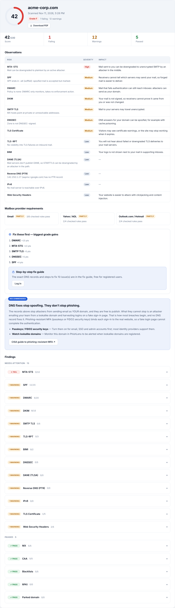
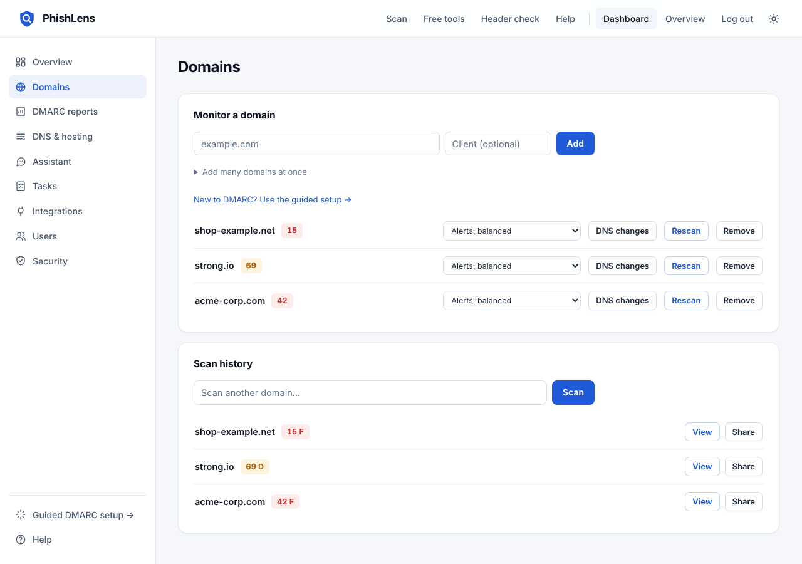
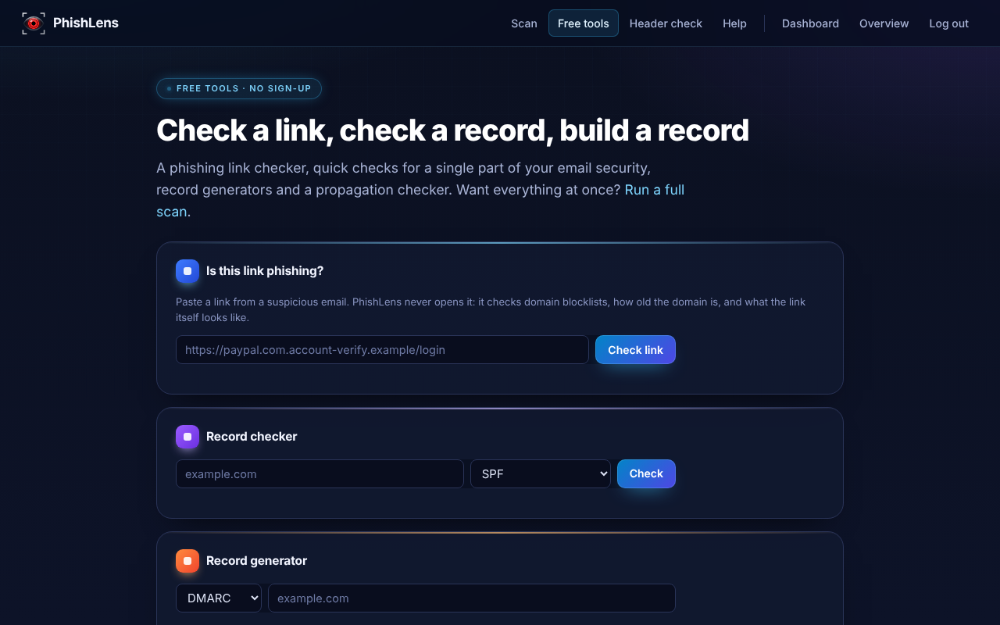
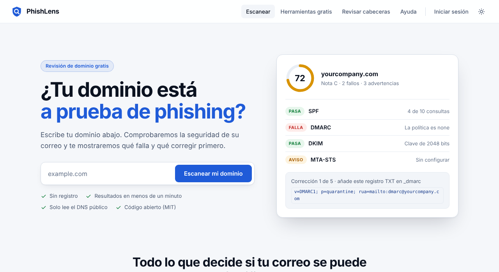

<div align="center">

# PhishLens

**Open-source email security: domain scanning, DMARC monitoring and one-click fixes.**

[](https://github.com/xsignon-secure/PhishLens/actions/workflows/ci.yml)
[](LICENSE)
[](https://github.com/xsignon-secure/PhishLens/pkgs/container/phishlens)


[Features](#features) · [Plans](#plans) · [Quick start](#quick-start) · [Configuration](#configuration) · [Security](#security) · [Documentation](#documentation)

</div>

---

PhishLens grades a domain's email security in seconds, tells you exactly which
DNS records to publish, and keeps watching so you hear about it when something
breaks. It reads DMARC and TLS reports, spots lookalike domains, and can
publish fixes for you at your DNS provider.

It is MIT-licensed and self-hostable in one command. A self-hosted copy has
every feature. XSignOn also runs a hosted service with
[Free, Pro and MSP plans](#plans).

- **No AI, no tracking.** Scans are plain DNS and HTTPS lookups.
- **Standards-current.** DMARC checks follow the 2026 DMARC update (RFC 9989–9991:
  `t=`, `np=`, `psd=`; `pct`, `rf` and `ri` flagged as obsolete).
- **Built for teams and MSPs.** Company isolation, roles, white-label reports,
  SIEM and PSA integrations.
- **Nine languages.** English, Spanish, French, German, Portuguese, Hindi,
  Italian, Dutch and Japanese (machine-translated; corrections welcome).

| Scan report | Dashboard |
|---|---|
|  |  |
| **Phishing link checker** | **Translated pages** |
|  |  |

## Features

### Domain scanner

One scan grades a domain across **13 checks**, scores it 0–100 and returns the
exact records to publish for every failing check, with step-by-step fix cards
for your DNS provider.

- SPF, DKIM (selector auto-detection and real key-strength checks), DMARC,
  BIMI, MTA-STS, TLS-RPT, MX, SMTP STARTTLS, DNS blocklists, DNSSEC, TLS
  certificate and web security headers.
- Also reported: DANE/TLSA, reverse DNS (PTR/FCrDNS), IPv6 and optional RPKI
  for mail servers; BIMI certificates (VMC/CMC) and SVG Tiny PS logos.
- PDF export, score history, and observations ranked by risk, severity,
  impact and fix.

### Monitoring and alerts

- Scheduled rescans with drift alerts and a DNS change timeline per domain.
- Alert levels from Essential (DMARC only) to Comprehensive (any change to
  SPF, DMARC, DKIM, BIMI, MTA-STS, TLS-RPT, MX, NS or A records).
- Email, Slack, Microsoft Teams, Discord and signed webhooks.
- Lookalike-domain watch: typo, homoglyph, keyword and TLD variants ranked by
  risk.
- Scheduled weekly or monthly PDF reports; a multi-domain overview for MSPs.

### DMARC and TLS reporting

- Aggregate (RUA) reports by upload, API, or automatic import from IMAP,
  Microsoft 365 or Gmail.
- Traffic grouped by sending service, with pass rates, a fix for each failing
  sender, and a clear signal for when it is safe to move to quarantine or reject.
- Senders classified as approved, authorized, needs a fix, suspicious or not
  ours, with a confidence score; approve or block them, or auto-approve.
- Enforcement autopilot: moves p=none to quarantine to reject on its own when
  reports show it's safe, and steps back if real mail starts failing
  (through hosted DMARC or your connected DNS provider). Runs with the
  scheduled rescans (`RESCAN_INTERVAL_HOURS`).
- Forensic (RUF) reports with headers only, optionally PGP-encrypted to your key.
- SMTP TLS (TLS-RPT) reports, DKIM key health, sending hosts, countries and
  daily volume charts.

### Fixing, not just finding

- Hosted DMARC, SPF (with flattening), MTA-STS, TLS-RPT, BIMI and DKIM records
  ([docs/HOSTED-RECORDS.md](docs/HOSTED-RECORDS.md)).
- One-click DNS fixes (with undo) on Cloudflare, DigitalOcean, deSEC, GoDaddy,
  Amazon Route 53, Hetzner, Porkbun, Vultr, Linode (Akamai) and Gandi, plus Domain Connect ([docs/DOMAIN-CONNECT.md](docs/DOMAIN-CONNECT.md)).
- A guided `/setup` flow: domain, DMARC policy, publishing and alerts.

### Free public tools

No account needed at `/tools`: a phishing link checker, an email header
analyzer, single-record checkers, record generators (DMARC, SPF with a live
lookup meter, MTA-STS, TLS-RPT, BIMI), a BIMI logo checker with an inbox
preview, and a DNS propagation checker. Signed-in users also get a test-email
address that shows SPF, DKIM, DMARC alignment and the delivery path.

### Integrations

- **SIEM:** syslog (RFC 5424 over UDP, TCP or TLS) and Splunk HEC.
- **PSA and helpdesk:** Zammad, GLPI, ConnectWise Manage, HaloPSA and Autotask
  ([docs/INTEGRATIONS.md](docs/INTEGRATIONS.md)).
- **MCP server** at `/mcp`, so Claude or any MCP client can scan domains and
  read reports ([docs/MCP.md](docs/MCP.md)).
- **Built-in AI assistant** (Dashboard → Assistant): ask about your domains in
  plain words; it reads your company's scans, monitors, alerts and DMARC data
  before answering. Uses Claude with the company's own Anthropic API key, or
  the server's `ANTHROPIC_API_KEY`; off when neither is set.
- REST API with API keys, and a Prometheus `/api/metrics` endpoint for Grafana.
- **White-label:** your name, colour, logo and footer on shared reports, PDFs
  and alert emails.

## Plans

**Self-hosting?** You get everything. Plans are off by default
(`PLANS_ENABLED=false`) and every company has every feature.

**Hosted service.** With `PLANS_ENABLED=true`, each company is on a Free, Pro
or MSP plan, set by the platform admin at `/platform`. Limits are enforced on
the server, locked features show a Pro or MSP badge in the dashboard, and a
downgrade never deletes data or breaks hosted DNS records.

| | Free | Pro | MSP |
|---|:---:|:---:|:---:|
| Public scanner and free tools | ✓ | ✓ | ✓ |
| Email alerts, fix cards, PDF of a scan | ✓ | ✓ | ✓ |
| Authenticator app, sessions, company isolation | ✓ | ✓ | ✓ |
| Monitored domains | 2 | 25 | Unlimited |
| Users | 2 | 10 | Unlimited |
| Automatic rescans | Weekly | Daily | Hourly |
| DMARC report domains | 1 | Unlimited | Unlimited |
| DMARC and TLS report history | 14 days | 1 year | 2 years |
| Audit log history | 7 days | 90 days | 1 year |
| Failure (RUF) and TLS reports | | ✓ | ✓ |
| Lookalike domain watch | | ✓ | ✓ |
| Hosted records and one-click DNS fixes | | ✓ | ✓ |
| Scheduled reports and shared report links | | ✓ | ✓ |
| Webhooks, chat alerts and API keys | | ✓ | ✓ |
| White-label branding | | | ✓ |
| SIEM and PSA / helpdesk tickets | | | ✓ |
| AI assistant connection (MCP) | | | ✓ |

Security features are in every plan. Limits live in `app/plans.py`; details in
[docs/PLANS.md](docs/PLANS.md).

## Quick start

### Docker

```bash
SECRET_KEY=$(python3 -c "import secrets; print(secrets.token_hex(32))") \
ADMIN_PASSWORD='choose-a-long-random-password' \
docker compose up -d
# open http://localhost:8000
```

`docker-compose.yml` runs PhishLens with Postgres and weekly built-in rescans.
A prebuilt image is published on every push to `main`:
`ghcr.io/xsignon-secure/phishlens:latest`.

### Python

```bash
python3 -m venv .venv && .venv/bin/pip install -r requirements.txt
cp .env.example .env          # set SECRET_KEY and ADMIN_PASSWORD
.venv/bin/alembic upgrade head
.venv/bin/uvicorn app.main:app --port 8000
```

### First sign-in

1. Open `/platform` and sign in with `ADMIN_PASSWORD`.
2. Create a company and its owner. The owner's login details are emailed, or
   shown once on screen if no mail server is set.
3. The owner signs in at `/login`, chooses a password and sets up an
   authenticator app, then adds the company's mail server and users.

Full walkthrough: [docs/ACCOUNTS.md](docs/ACCOUNTS.md). Single sign-on (SAML or OIDC) for existing accounts: [docs/SSO.md](docs/SSO.md).

## Configuration

All settings are environment variables; `.env.example` lists every one.

| Variable | Purpose |
|---|---|
| `SECRET_KEY` | Required. Signs sessions and encrypts stored secrets. |
| `DATABASE_URL` | Postgres for production; SQLite (`phishlens.db`) by default. |
| `ADMIN_PASSWORD` | Opens `/platform` to create companies and owners. |
| `APP_URL` | Public address used in emails and links. |
| `SMTP_*` | Server-wide mail fallback; each company can set its own. |
| `RESCAN_INTERVAL_HOURS` | Built-in rescans (e.g. `168` weekly, `1` hourly). |
| `REPORT_FETCH_MINUTES` | Import DMARC/TLS reports from IMAP, Microsoft 365 or Gmail. |
| `PLANS_ENABLED` | `true` turns on hosted plans. Off by default. |
| `SIGNUP_ENABLED` | `true` opens `/signup`: anyone can create a free company account (login details go to their email). Needs `SMTP_*`. Off by default. |
| `RATE_LIMIT_STORAGE` | `database` to share limits across several instances. |
| `VIRUSTOTAL_API_KEY`, `SAFE_BROWSING_API_KEY`, `URLHAUS_AUTH_KEY`, `OPENPHISH_FEED` | Optional reputation and link-checker feeds. |
| `RPKI_CHECK`, `GEOIP_DB` | Optional RPKI lookups and DMARC sender countries. |
| `MAX_MONITORS_PER_TEAM`, `SCAN_RATE_LIMIT_PER_HOUR` | Abuse brakes for public instances. |

### Deployment

- **Render / Fly.io:** use the GHCR image or the `Dockerfile` with a free
  Postgres such as Neon ([docs/DEPLOY-RENDER.md](docs/DEPLOY-RENDER.md)).
- **Single VPS:** systemd, uvicorn and Caddy for TLS.
- Behind a proxy, run uvicorn with `--proxy-headers` (the Dockerfile does).
- Full checklist: [docs/DEPLOY.md](docs/DEPLOY.md). Schema changes use Alembic
  ([docs/ENTERPRISE.md](docs/ENTERPRISE.md)).

## Security

- **Admin-created accounts by default:** no invite links and no
  self-service reset. The platform admin creates companies and owners but
  never sees company data. A hosted service can turn on `SIGNUP_ENABLED`,
  which lets anyone create a free company (login details go to the email
  given, so the address is verified; per-IP and hourly caps).
- **Free report vs fix guide:** anyone can scan and see the findings; the
  exact fix records and step-by-step fix guide (in the app and as a PDF) are
  for signed-in accounts only, enforced on the server for API responses,
  shared links and PDFs.
- **Hard company isolation:** every query is scoped to the signed-in company;
  another company's ids answer 404, and tampered tokens are refused and logged
  as critical.
- **Strong sign-in:** Argon2id passwords with a breached-password check,
  single-use temporary passwords, a required authenticator app for owners and
  admins, account lockout and rate limits.
- **Sessions:** 15-minute tokens with rotating refresh tokens in httpOnly
  cookies, idle and absolute expiry, replay detection, per-device sign-out.
  Sensitive changes need a fresh authenticator code.
- **Secrets at rest:** MFA seeds and company SMTP passwords are encrypted and
  never returned by the API.
- **Input hardening:** strict domain validation and an SSRF guard on every
  outbound request the scanner and webhooks make.

Threat model and pen-test checklist: [docs/ACCOUNTS.md](docs/ACCOUNTS.md).
Report vulnerabilities privately as described in [SECURITY.md](SECURITY.md).

## Scoring

| Check | Points | Notes |
|---|:---:|---|
| DMARC | 20 | reject 20, quarantine 12, none 5; −3 for `t=y` or legacy `pct<100`, −2 without `rua` |
| SPF | 15 | `-all` 15, `~all` 11; fails on more than 10 lookups or `+all` |
| DKIM | 15 | 2048-bit or more 15, 1024-bit 8 |
| MTA-STS | 10 | enforce 10, testing 4 |
| MX and SMTP STARTTLS | 5 + 5 | |
| TLS-RPT and BIMI | 3 + 2 | |
| DNSSEC, DNS blocklists, CAA | 5 + 5 + 5 | 7 IP lists plus Spamhaus DBL, SURBL and URIBL |
| TLS certificate, web security headers | 5 + 5 | |

## Architecture

FastAPI, SQLAlchemy with Alembic, server-rendered Jinja templates and vanilla
JavaScript with no build step.

```
app/
  main.py, config.py      app setup, security headers, settings
  models.py, database.py  SQLAlchemy models (SQLite or Postgres)
  plans.py                hosted plan limits and features
  scanner/                DNS, mail and web checks, scoring, fix guides
  routers/                auth, users, platform, scans, monitors, DMARC, TLS-RPT,
                          hosted records, integrations, MCP, pages
  templates/, static/     UI and translations (app/locales)
scripts/                  rescans and report import jobs
tests/                    pytest suite
```

Run the tests with `.venv/bin/python -m pytest tests/ -q`.

## Documentation

| Guide | Covers |
|---|---|
| [ACCOUNTS.md](docs/ACCOUNTS.md) | Companies, roles, sign-in, threat model |
| [SSO.md](docs/SSO.md) | Single sign-on with SAML 2.0 or OpenID Connect (Okta, Entra ID, Google) |
| [PLANS.md](docs/PLANS.md) | Hosted Free / Pro / MSP plans |
| [DEPLOY.md](docs/DEPLOY.md) · [DEPLOY-RENDER.md](docs/DEPLOY-RENDER.md) | Production deployment |
| [HOSTED-RECORDS.md](docs/HOSTED-RECORDS.md) | Hosted DMARC, SPF, MTA-STS, BIMI, DKIM |
| [DOMAIN-CONNECT.md](docs/DOMAIN-CONNECT.md) | One-click publishing |
| [INTEGRATIONS.md](docs/INTEGRATIONS.md) | Report mailboxes, SIEM, PSA, helpdesks |
| [MCP.md](docs/MCP.md) | AI assistant connection |
| [ENTERPRISE.md](docs/ENTERPRISE.md) | Database migrations and operations |
| [MARKET-ANALYSIS-2026-10.md](docs/MARKET-ANALYSIS-2026-10.md) | How PhishLens compares |

## Contributing

Contributions are welcome. See [CONTRIBUTING.md](CONTRIBUTING.md) and
[CODE_OF_CONDUCT.md](CODE_OF_CONDUCT.md). Native-speaker reviews of the
translations in `app/locales` are especially helpful.

## License

[MIT](LICENSE). Use it, change it, self-host it. The hosted service and its
plans are run by XSignOn; the code is the same.
